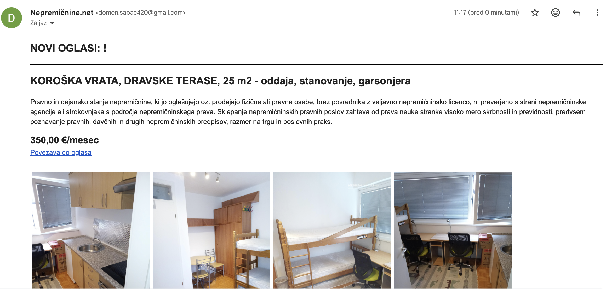

# NepremicnineScraping

<p float="left">
  
</p>

**Runs only on local device, because of Cloudflare protection**

While you are away, you may miss a great deal. This scraper was supposed to fix that.

App features
- Scraping Nepremicnine.net
- Alerting via email

## Tech stack


 


## Getting Started
To get the project running, follow these steps.

### Prerequisites
Bun required

- macOS: `brew install bun`
- Windows: `winget install Oven-sh.Bun`

### Installation

1.  Clone the repo
    ```sh
    git clone https://github.com/domensapac/nepremicnine-scraping.git
    ```
    ```sh
    cd nepremicnine-scraping
    ```
2.  Create .env file and fill following
    ```sh
    SUPABASE_URL=
    SUPABASE_ANON_KEY=
    NODEMAILER_PASS= //google 16 digit app password
    NODEMAILER_ADDRESS= 
    ```
3.  Install bun packages 
    ```sh
    bun install
    ```
4.  Install playwright
    ```sh
    bunx playwright install
    ```
5.  Run the scraper
    ```sh
    bun run index.ts
    ```